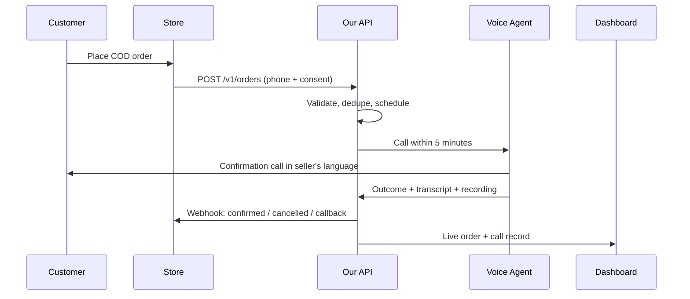
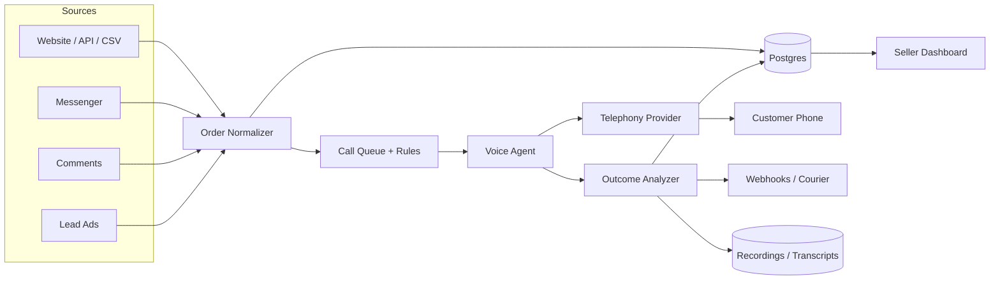

# CustomerCenter AI — Product & Go-to-Market Plan

**AI order confirmation for Facebook-first B2B sellers — in the seller's language, under the seller's brand**

Version 0.2 · 23 October 2026 · Working draft

> **What changed in v0.2 (after your feedback)**
> - The product is **B2B SaaS sold to sellers**; the people called are the seller's buyers.
> - **Language is a per-seller setting**, not a Bangla-only product. Bangla + English are the first packs; the architecture supports any locale.
> - **Messenger is the first Facebook surface**, with comments and Lead Ads after it.
> - The stack is designed for **low COGS**: chat-first escalation, local SIP, small models, and a managed-to-self-hosted migration path.
> - Pricing is designed to keep **60%+ gross margin** on the starter plan, not just to win logos.

---

## 0. The short answer

**Facebook is not a phone channel.** There is no Meta API that lets your app call a customer. Messenger is a chat channel with strict rules about when you may message someone. So the product is really two layers:

1. **Intake layer** — turn website orders, Messenger chats, post comments, and Lead Ads into a structured order with a phone number and consent.
2. **Confirmation layer** — an AI voice agent calls that number, confirms the product/price/address, and writes back a clean outcome.

Build the confirmation engine **once**. Treat the website and Facebook as **adapters** around it.

- The website adapter is easy: you already control the order data and the phone number.
- The Facebook adapter is harder: OAuth, webhooks, App Review, 24-hour/7-day messaging windows, no phone number in the profile, and unstructured chat. But Facebook is where the orders are, so you cannot skip it.

**The sequence I recommend:**

> Build the voice engine + website/CSV intake first (2–3 weeks). Start Meta Business Verification and App Review in week 1, in parallel, because approval takes weeks. Add Messenger, comments, and Lead Ads once the voice engine is proven with real sellers.

**This is not a pivot away from Facebook.** Messenger is the product priority; the website/CSV adapter is the test bench you can ship while Meta reviews your app. The moment App Review clears, Messenger becomes the front door.

**Do not build a generic "AI call center."** Build one workflow: **COD order confirmation in the seller's language, within 5 minutes of the order, with address repair and a clean outcome for the seller.** That is the wedge.

Because this is **B2B SaaS**, the seller is your customer. The seller configures the language, voice, brand name, script, call hours, retry rules, and confirmation mode. The buyer experiences the **seller's brand**, not yours.

> **Assumption:** "product purchases" means consumer e-commerce orders, mostly cash-on-delivery (COD), from Facebook/Instagram sellers and website stores. The first validation market is Bangladesh because of your distribution and language advantage, but the product is built to be **market- and language-agnostic**. If you mean B2B distributor purchase orders, the same engine applies but the script, consent model, and integrations change — see §14.

### Plan at a glance

| Decision | Recommendation |
|---|---|
| **Product model** | B2B SaaS sold to sellers; white-label calls to their buyers |
| **Beachhead market** | Bangladesh Facebook/Instagram COD sellers, 300–3,000 orders/month |
| **Expansion** | Same product, new **language packs** and local telephony — not a rebuild |
| **Wedge** | AI voice confirmation of COD orders within 5 minutes |
| **Core output** | Structured outcome: confirmed / cancelled / callback / wrong number / address fixed |
| **Language** | Seller-configured default + fallback; Bangla and English first |
| **Confirmation mode** | Chat → call escalation (configurable per seller) |
| **Channel strategy** | Voice out; Facebook is intake + in-window chat |
| **Build order** | Voice engine + website/CSV → Messenger → comments → Lead Ads |
| **Voice stack (first 1,000 calls)** | Vapi or Retell + Twilio/Plivo; local SIP later |
| **Pricing (hypothesis)** | ৳2,500–3,000/mo + per confirmed order or usage; 60%+ gross margin on Starter |
| **Time to pilot** | 3 weeks |
| **Time to Facebook live** | 8–12 weeks, mostly App Review |
| **Biggest risk** | Unit economics vs. cheap human callers; local CLI, chat-first escalation, and short calls are mandatory |

### Glossary

- **COD** — cash on delivery.
- **RTO** — return to origin; an undelivered parcel sent back to the seller.
- **PSID** — Page-Scoped ID; Meta's per-Page identifier for a user.
- **CTM** — Click-to-Messenger ad.
- **ASR** — automatic speech recognition (speech-to-text).
- **TTS** — text-to-speech.
- **CLI** — caller line identification; the number the customer sees.
- **DNC** — do-not-call list.
- **NDR** — non-delivery report from a courier.
- **AOV** — average order value.
- **3PL** — third-party logistics provider.
- **SIP** — Session Initiation Protocol; the standard way to connect calls to a carrier.
- **PSTN** — the public switched telephone network; normal phone lines.
- **AMD** — answering machine detection.
- **BYO** — bring your own (telephony, LLM, or TTS keys).
- **Language pack** — the script, prompts, voice settings, and QA data for one locale.

---

## Table of contents

1. [What we are building](#1-what-we-are-building)
2. [Why this market](#2-why-this-market)
3. [Customer and wedge](#3-customer-and-wedge)
4. [The two channels: website vs Facebook](#4-the-two-channels-website-vs-facebook)
5. [Facebook integration in detail](#5-facebook-integration-in-detail)
6. [End-to-end flows](#6-end-to-end-flows)
7. [The AI call](#7-the-ai-call)
8. [Architecture](#8-architecture)
9. [Unit economics and pricing](#9-unit-economics-and-pricing)
10. [Go-to-market](#10-go-to-market)
11. [Roadmap](#11-roadmap)
12. [Metrics and proof](#12-metrics-and-proof)
13. [Risks](#13-risks)
14. [Open decisions](#14-open-decisions)
15. [What to build first in this repo](#15-what-to-build-first-in-this-repo)
16. [Sources](#16-sources)
17. [Appendix A — Bangla call script (first language pack)](#appendix-a--bangla-call-script-first-language-pack)
18. [Appendix B — Facebook App Review checklist](#appendix-b--facebook-app-review-checklist)
19. [Appendix C — API payloads](#appendix-c--api-payloads)
20. [Appendix D — 30-day validation plan](#appendix-d--30-day-validation-plan)
21. [Appendix E — Language pack schema](#appendix-e--language-pack-schema)

---

## 1. What we are building

### 1.1 One sentence

> **CustomerCenter AI calls every new cash-on-delivery order within minutes, confirms the product, price, and address in the seller's chosen language and voice, and tells the seller what to ship — before the courier is booked.**

### 1.2 The job to be done

A Facebook seller gets an order in Messenger, a comment, a lead form, or a website checkout. The order has a phone number and an address, but the seller does not know:

- Is this a real order, or an impulse/fake order?
- Is the phone number real and reachable?
- Is the address complete enough for the courier?
- Is the customer actually going to accept the parcel and pay cash?
- Should we ship it, hold it, or cancel it?

Today the seller either calls manually, sends a WhatsApp/Messenger message, or ships blindly. The result is **RTO (return to origin)**: the parcel comes back, the seller pays courier charges both ways, and the product is tied up for weeks.

Our job is to turn a messy order into a **confirmed, dispatch-ready order** with a structured outcome.

### 1.3 What the seller actually buys

| Value | How we deliver it |
|---|---|
| Fewer returns (lower RTO) | Confirm intent before dispatch; cancel bad orders early |
| Faster dispatch | Call within 5 minutes, not next day |
| Fewer failed deliveries | Repair address, landmark, delivery time window |
| More prepaid orders (optional) | Offer a small prepaid discount on the call |
| Higher order value (optional) | Add a relevant upsell on the call |
| Labor savings | Replace/assist manual confirmation callers |
| Visibility | Recording, transcript, outcome, reason codes, dashboards |
| Consistency | Same script, same questions, every order, 24/7 |
| Brand control | Seller's name, voice, language, and script — not a generic bot |
| Low overhead | No hiring, no training, no extra phone lines |

The seller is not buying "AI" or "minutes." They are buying **fewer lost parcels and a faster, cleaner dispatch process**.

### 1.4 What we are not (v1)

- Not an inbound customer support desk.
- Not a general sales chatbot.
- Not a Messenger broadcast tool.
- Not a replacement for complex human sales calls.
- Not a Shopify App Store product yet.
- Not a call center with 50 agents.

One workflow, done well, is the whole MVP.

---

## 2. Why this market

### 2.1 The COD problem is the wedge

Bangladesh is a cash-on-delivery market. Industry estimates put COD at roughly **70–80% of e-commerce orders**, and COD orders return at **20–30%** versus low single digits for prepaid orders. Every RTO costs the seller:

- courier charge both ways (typically ৳120–200 depending on weight/zone),
- packaging and handling,
- capital tied up for weeks,
- possible product damage or seasonality loss,
- a lost sale that may never be recovered.

The highest-leverage fix is **before dispatch**: confirm the order, confirm the address, and confirm that someone will be there with cash. That is exactly the job an AI voice agent can do at scale.

### 2.2 Why Facebook is the right battlefield

In Bangladesh, a huge share of social commerce happens on Facebook Pages and Messenger, not on a Shopify checkout:

- Customers ask "দাম কত?" in comments and then order in Messenger.
- Sellers collect name, phone, address, and product details in chat.
- There is no reliable checkout, no order API, and no phone number in the Facebook profile.
- Orders are unstructured text, voice notes, and screenshots.

This is painful for sellers, which means **the intake layer itself is valuable**. A tool that reads the chat, extracts the order, and then calls to confirm is much more useful than a generic dialer.

Meta also gives you intent signals a website-only tool cannot see:

- **Messenger conversations** — high intent, already talking to the seller.
- **Post comments** — "price?", "inbox", "order korte chai" — high intent, public.
- **Lead Ads** — name + phone + form answers, ready to call.
- **Click-to-Messenger ads** — paid traffic that opens a chat window of up to **7 days** (since 28 September 2026). This is the best Facebook entry point for a confirmation workflow in BD.

### 2.3 Why now

1. **Local-language voice AI is finally usable.** For the beachhead: ElevenLabs supports Bengali on v3/v4, Azure has `bn-BD` voices (Nabanita, Pradeep), Google has `bn-BD` STT (Chirp 3, preview) and Gemini-TTS `bn-BD`. Other launch languages have similar coverage; validate per language.
2. **Telephony APIs cover most markets, including Bangladesh outbound.** Twilio lists BD at ~$0.060/min, Plivo at ~$0.046/min. (Local SIP/CLI is still the hard part — see §9.7.)
3. **Meta tightened the rules.** Message tags were deprecated in April 2026; generic broadcast tools are being forced to become compliant workflow tools. That is an opening for a product that respects the windows and still gets the job done.
4. **Sellers are under margin pressure.** RTO is a board-level metric for e-commerce brands, and Facebook sellers feel it every week.

### 2.4 Why language must be a seller setting

If you hard-code Bangla:

- you can only sell to Bangla-speaking sellers;
- a Bangladeshi seller with English-speaking buyers cannot use it;
- a seller in the UAE with Arabic/Hindi/Urdu buyers is out of reach;
- every new market becomes a fork of the product, not a configuration.

If language is per-seller:

- one codebase, one prompt pipeline, many markets;
- the seller chooses default language, fallback, voice, and approved script variations;
- expansion is a **language pack + local telephony + QA**, not a rewrite;
- your moat becomes **language-pack quality and local operations**, not "we speak Bangla."

The seller must be able to configure:

- default language and fallback language,
- voice (gender, accent, speed, style),
- brand name, approved greeting variations, and transfer number (the AI disclosure is locked),
- call hours, retries, and confirmation mode,
- a preview of exactly what the buyer will hear.

**Do not sell a language until you have a QA set:** 100+ real calls, slot accuracy > 90%, and a native reviewer. A language pack without QA is a liability.

### 2.5 Why cost is a product feature

Your COGS are dominated by telephony and voice. If you use a managed voice platform plus international wholesale on every call:

- all-in cost is roughly **$0.15/min**;
- a 1.3-minute call costs ~**$0.20 (~৳24)**;
- at ৳15/call, you lose money;
- at ৳25/call, you are priced out of small sellers.

To sell profitably, cost has to be engineered:

- **chat-first** — confirm in Messenger for near-zero marginal cost; call only non-responders and high-value orders;
- **local SIP** — typically 3–10× cheaper than international wholesale;
- **short, structured calls** — 45–90 seconds, not open-ended chat;
- **small models** — cheap LLM for dialogue, batch analysis after the call;
- **BYO telephony/keys** — the seller pays the carrier, you sell software.

This is covered in detail in §9.

---

## 3. Customer and wedge

### 3.1 Ideal customer profile (ICP)

**Primary:** Bangladesh Facebook/Instagram sellers in fashion, cosmetics, home, and gadgets with:

- 300–3,000 COD orders/month,
- 3–20 operations staff,
- orders coming through Messenger, comments, and phone,
- shipping with Pathao, Steadfast, RedX, or Paperfly,
- currently confirming by phone/WhatsApp or not at all,
- a painful RTO number (25%+),
- a brand and a language they care about (Bangla, English, or both).

**Who buys (the B2B buyer):**

- Founder/owner or head of operations — cares about RTO, cash flow, and headcount.
- E-commerce manager — cares about dispatch speed, address quality, and courier performance.
- Customer support lead — cares about script consistency, recordings, and escalations.
- Agency account manager — cares about white-label reporting across client Pages.

**What they need to configure:**

- default language + fallback, voice, brand name, greeting, disclosure, transfer number,
- confirmation mode (chat only / call only / chat-then-call),
- call hours, retries, DNC rules, budget caps,
- catalog, courier, and order-source integrations.

**Secondary:**

- Website/WooCommerce/Shopify brands with COD and a real order API.
- Agencies managing 10–50 Facebook Pages (white-label opportunity).
- Couriers/3PLs who want to offer confirmation as a value-added service to their sellers.
- Sellers in the Gulf, Southeast Asia, and South Asia with South Asian diaspora buyers — same engine, new language pack and local number.

**Not first:**

- Enterprise brands with an existing 50-seat call center (long sales cycle, procurement).
- Pure prepaid stores (low RTO, less pain).
- Very low-AOV impulse sellers (call cost is too high relative to margin).
- Sellers who only want a generic chatbot (we are a confirmation workflow, not a chat toy).

### 3.2 The wedge

> **COD order confirmation for Facebook-first sellers — in the seller's language, under the seller's brand.**

One workflow. One outcome. One dashboard. The seller configures language and voice; the buyer hears the seller's brand. Expand later into delivery scheduling, NDR recovery, prepaid conversion, upsell, and inbound support.

### 3.3 Positioning

- **For sellers:** "Confirm every COD order in 5 minutes — in your language, under your brand — before you ship."
- **For agencies:** "White-label AI confirmation for all your client Pages."
- **For couriers:** "Cut RTO for your sellers without adding call-center headcount."

Avoid these phrases:

- "AI call center" — commodity, scares call centers, invites comparison on price per minute.
- "Automate all customer support" — too broad, impossible to prove.
- "Message all your customers on Messenger" — violates Meta policy and gets apps restricted.

---

## 4. The two channels: website vs Facebook

### 4.1 Website (the easy adapter)

**Flow:**

1. Checkout or order API sends order + phone + consent to us.
2. We call within 5 minutes.
3. We write the outcome back via webhook.
4. Seller ships, holds, or cancels.

**Why it is easy:** you control the order data, the phone number, and the consent language. There is no Meta review, no messaging window, no unstructured chat.

**What is still hard (shared with Facebook):**

- telephony and caller ID,
- speech recognition in each launch language,
- answer rates,
- call consent and recording disclosure,
- cost per call.

**Integrations, in order of effort:**

| Integration | Effort | When |
|---|---|---|
| CSV upload | 1–2 days | Week 1 |
| REST API + HMAC webhook | 2–3 days | Week 1 |
| WooCommerce plugin | 1 week | Week 4–5 |
| Shopify app | 3–4 weeks + review | Month 3+ |
| Custom "Confirm order" JS snippet | 1 week | Month 2 |

### 4.2 Facebook (the hard adapter, but where the orders are)

There are **four Facebook entry points**, plus a website-to-Messenger bridge. They behave differently. This is the part most people get wrong.

| Entry point | What you get | Messaging window | What to do |
|---|---|---|---|
| **Messenger DM / organic chat** | PSID, message text, attachments | 24 hours from the user's last action | Chat, collect phone + address, create order, call, send confirmation card |
| **Click-to-Messenger ad** | PSID + ad referral | Up to **7 days** from the first message after the ad click | Same as above, with more room to converse |
| **Page post comment** | Commenter ID, comment text, post ID | One **private reply** within 7 days; then 24h after the person replies | Reply privately, move to Messenger, collect phone, call |
| **Lead Ads form** | Name, phone, email, custom answers; no PSID | No chat window; phone call is separate | Fetch lead via `leadgen` webhook, call in <5 minutes, update CRM |
| **Website + Send to Messenger / checkbox plugin** | Links a website session to a PSID + opt-in | Opens a messaging window | Optional: let website buyers opt into Messenger updates |

**What Facebook does not give you:**

- ❌ No API to place an outbound phone call.
- ❌ No phone number from the user's profile.
- ❌ No cold DMs outside the allowed window.
- ❌ No unlimited follow-ups.
- ❌ No guarantee of delivery, open, or read.
- ❌ No way to "just call" a commenter.

**So the product must capture the phone number first, then use telephony for the actual confirmation call.** Facebook is the **intake + in-window chat** layer; voice is the **reliable outbound** layer.

**Why not WhatsApp first?** WhatsApp Business API is a strong channel in Bangladesh, but it is template-based outside the 24-hour service window, charges per delivered template, and requires opt-in. It is a good **phase 3** addition (order updates, missed-call follow-up, prepaid links), not the wedge. Facebook is where the product discovery and ordering behavior already happens for this ICP.

### 4.3 The policy rules that shape the product

These are not fine print. They determine what the product can promise.

| Rule | What it means | Product implication |
|---|---|---|
| **Standard messaging window** | 24 hours from the user's action; up to 7 days for the first message after a Click-to-Messenger / Click-to-Direct ad | Track the window per PSID; choose message type programmatically |
| **Message tags deprecated** | `CONFIRMED_EVENT_UPDATE`, `ACCOUNT_UPDATE`, `POST_PURCHASE_UPDATE` return error 100 since 27 April 2026 | Do not build on tags; use utility templates or Marketing Messages |
| **Utility templates** | Order/account updates and appointment reminders; no marketing; template approval; `page_utility_messaging` permission; `messaging_type=UTILITY` | Use for order status outside the window, not for promotional follow-ups |
| **HUMAN_AGENT tag** | 7 days, **human-written only**, support use cases; App Review required | Never let the bot send with HUMAN_AGENT; route to a human if needed |
| **Private replies** | One message within 7 days of a comment | Use once to move the commenter into Messenger; do not spam |
| **Marketing Messages API** | Paid, opt-in, outside the window; separate API | Later, if ever; not needed for confirmation |
| **Responsiveness** | Automated bots must respond to user input within 30 seconds | Chat agent must be fast and always reply, even with "let me check" |
| **Lead data retention** | Lead data available for 90 days | Fetch and store only what you need; delete per policy |
| **App Review + Business Verification** | Required for advanced access to messaging/lead permissions | Start in week 1; it is the long pole |

**The single most important product decision:** **voice is the outbound channel, Facebook is the intake channel.** If you build the product the other way around — assuming you can message anyone on Messenger whenever you want — Meta will restrict the app and your sellers will lose access.

### 4.4 What the Facebook product actually looks like

Three surfaces, built in this order:

1. **Inbox assistant (read + reply + extract order).**
   - Receives Messenger webhooks.
   - Discloses that it is an automated assistant at the start of the conversation (Meta recommends this; some jurisdictions require it).
   - Answers common questions (price, delivery, stock) from the seller's catalog (CSV/Google Sheet/WooCommerce sync in v1).
   - Collects name, phone, address, product, variant, quantity.
   - Asks permission to use the phone number for the confirmation call.
   - Creates a structured order and asks for confirmation.
   - Sends a "We'll call you in 2 minutes to confirm" message while the window is open.
   - Then triggers the voice call.

2. **Comment-to-order.**
   - Receives `feed` webhooks for comments on the Page's posts.
   - Sends one private reply with a Messenger link.
   - Once the person replies, the 24-hour window opens and the inbox assistant takes over.

3. **Lead Ads fast-call.**
   - Receives `leadgen` webhooks.
   - Fetches the lead via Graph API.
   - Validates the phone number.
   - Calls within 5 minutes (speed-to-lead matters).
   - Writes the outcome back to the CRM/webhook.

**Do not start with a full inbox replacement.** Start with order extraction + confirmation. The seller keeps their existing inbox tool if they want; we plug into the order flow.

### 4.5 What the seller configures

The product is B2B SaaS, so configuration is part of the product, not an admin afterthought.

| Setting | What the seller chooses | Default |
|---|---|---|
| **Default language** | Language the agent speaks first | Bangla (BD sellers) / English |
| **Fallback language** | Used if the buyer speaks another supported language | English |
| **Voice** | Gender, accent, speed, style; preview before saving | Female, neutral, friendly |
| **Brand** | Display name, approved greeting variations, transfer number; AI disclosure is locked | Seller's Page name |
| **Confirmation mode** | `chat`, `call`, or `chat_then_call` | `chat_then_call` |
| **Call timing** | Immediate / delay / business hours | Within 5 minutes, 9am–9pm |
| **Retries** | Number of attempts, gaps, SMS between attempts | 2 attempts, +2h, next morning |
| **Budget cap** | Max spend per order / day / month | Plan-based |
| **Catalog** | CSV, Google Sheet, WooCommerce, or manual | Manual |
| **Outcome delivery** | Webhook, email, CSV, courier booking | Dashboard + webhook |

**Preview is mandatory.** Before going live, the seller hears a sample call in their language and voice, with their brand name and a sample order. This is also the best sales demo.

**Messenger-first means:** the Page inbox is the primary surface for order capture; the dashboard is the control room for calls, outcomes, and exceptions. Do not make the seller live in two tools.

---

## 5. Facebook integration in detail

### 5.1 What you need before writing code

- **Meta Business Portfolio** (Business Manager) for your company.
- **Business Verification** — legal entity name, address, phone, business documents. Start now; it can take days to weeks.
- **Meta app** of type **Business**.
- **Privacy policy** URL that explicitly covers Facebook Page data, Messenger messages, lead data, retention, and deletion.
- **Terms of service**.
- **Data deletion callback** URL and instructions.
- **Deauthorize callback** URL.
- **HTTPS webhook** with a valid certificate and a fast 200 response.
- **A test Facebook Page** with real conversations and a test lead form.

**Pilot shortcut if App Review is slow:** connect the seller's Page to an existing Messenger automation platform (ManyChat/Chatfuel) and forward new-message events to us via Zapier/Make. This is a temporary bridge for the first 1–2 pilots — not the core architecture. It adds cost, latency, and a dependency, and it may not give you raw webhook access. Use it to learn, then replace it with your own Meta app.

### 5.2 Permissions to request (start minimal)

| Permission | Why | When |
|---|---|---|
| `pages_show_list` | Let the seller choose which Page to connect | Phase 1 |
| `pages_manage_metadata` | Subscribe the app to Page webhooks | Phase 1 |
| `pages_messaging` | Read/send Messenger messages | Phase 1 |
| `pages_read_engagement` | Read comments/Page content for comment-to-DM | Phase 1 |
| `page_utility_messaging` | Send utility templates outside the 24h window | Phase 2 |
| `leads_retrieval` | Read Lead Ads form submissions | Phase 2 |
| `pages_manage_ads` / `ads_management` | Lead attribution and ad-level reporting | Phase 2 |
| `instagram_basic`, `instagram_manage_messages` | Instagram DM (same policy family) | Phase 3 |

**Rule:** request only what the demo needs. Every extra permission is another rejection risk and another data-retention obligation.

### 5.3 OAuth and Page connection

1. Seller clicks **Connect Facebook Page**.
2. Facebook Login for Business (or standard Facebook Login) returns a user token with the requested scopes.
3. Exchange for a long-lived user token, then fetch Page tokens via `GET /me/accounts`.
4. Store the Page token **encrypted** (KMS or app-level envelope encryption) with the Page ID, scopes, and connection status.
5. Subscribe the app to the Page:
   `POST /{page-id}/subscribed_apps` with `subscribed_fields=messages,messaging_postbacks,messaging_optins,message_reactions,feed,leadgen`.
6. On deauthorize or token error (`code 190`), mark the connection as disconnected and ask the seller to reconnect.

**Never** put Page tokens in the frontend, logs, or error messages.

### 5.4 Webhook receiver

**Verification (GET):**

```
GET /webhooks/meta?hub.mode=subscribe&hub.verify_token=...&hub.challenge=...
→ 200 with hub.challenge if the token matches
```

**Events (POST):**

1. Read the **raw body** (do not parse before signature verification).
2. Verify `X-Hub-Signature-256` = `sha256(app_secret, raw_body)` using a timing-safe compare.
3. Return `200` immediately (under 5 seconds).
4. Enqueue the event; process asynchronously.
5. Deduplicate by `message.mid`, `leadgen_id`, or a hash of the event.
6. Log the event with tenant, Page ID, type, and status for debugging.

**Why this matters for App Review:** reviewers test the webhook live. A timeout, a 404, or a failed handshake is a rejection.

### 5.5 Message window state machine

For every PSID, store:

- `last_user_message_at`,
- `window_source` (`organic`, `ctm_ad`, `plugin`, `comment_reply`),
- `window_expires_at` (24h or 7d),
- `last_bot_message_at`,
- `opted_out`,
- `human_takeover`.

Before sending, compute the allowed message type:

| Window state | Allowed | Not allowed |
|---|---|---|
| Open (24h/7d) | `RESPONSE` or `UPDATE`, promotional content allowed | Spam, harassment |
| Closed, utility need | Approved utility template with `UTILITY` | Marketing content, free-form promo |
| Closed, human support | `HUMAN_AGENT` written by a human | Bot messages, sales follow-ups |
| Closed, marketing | Marketing Messages API (paid, opt-in) | Free-form messages |

Build this as a **single guard function** used by every send path. Do not let feature teams call the Send API directly.

### 5.6 App Review: what actually gets approved

Meta reviewers are looking for a **working, end-to-end use case**, not a settings page. Prepare:

- A **3–5 minute screencast**, narrated, no cuts:
  1. Log in with Facebook.
  2. Select the test Page.
  3. Grant the permission.
  4. Send a message from a test user to the Page.
  5. Show the message arriving in your app.
  6. Create an order from the conversation.
  7. Trigger the call (or show the call record).
  8. Show the outcome in the dashboard.
  9. Show the webhook receiving a lead (if requesting `leads_retrieval`).
  10. Show the data deletion flow.
- A **privacy policy** that names Messenger, Page comments, Lead Ads, retention periods, and deletion.
- A **data deletion callback** that returns a confirmation URL and code.
- A **test Page** with real content and a reviewer test account.
- **Permission justifications** written in plain language: "We use `pages_messaging` to reply to customers who message the Page about an order, and to send order confirmation updates."
- **No fake data** in the demo. Reviewers can tell.

**Timeline:** plan for **2–6 weeks**, and assume at least one rejection. Submit early; do not block the pilot on it.

### 5.7 Data handling

- Store only the fields you need: PSID, name, phone, address, order, messages relevant to the order.
- Encrypt phone numbers and addresses at rest (field-level or envelope encryption).
- Recordings: private bucket, signed URLs, 90-day default retention, delete on request.
- Lead data: fetch within 90 days; do not retain beyond the stated purpose.
- Honor deletion requests across orders, calls, transcripts, and recordings.
- Publish a data processing addendum (DPA) for sellers.
- Train staff on PII access; log admin views.

---

## 6. End-to-end flows

### 6.1 Website COD order



**Timing targets:**

- Order received → call started: **< 5 minutes** (95th percentile < 10 min).
- Call length: **60–120 seconds**.
- Outcome available in dashboard/webhook: **< 30 seconds after hangup**.

### 6.2 Facebook Messenger order (primary flow)

1. Customer comments or DMs: "এই ড্রেসটার দাম কত?" / "order korte chai."
2. Bot replies in-window (or one private reply for a comment).
3. Bot detects the buyer's language and replies in it if the seller enabled that language; otherwise uses the seller's default.
4. **Chat confirmation first (default):** bot sends a confirmation card with product, variant, quantity, amount, and address, plus buttons:
   - ✅ Confirm order
   - 📍 Change address
   - ❌ Cancel
5. If the buyer confirms in chat and the address is complete, **no call is needed** — this is the cheapest and fastest path. Mark `confirmed_via_chat`.
6. If the buyer does not respond within the configured time, the address is incomplete, the order is above a value threshold, or the seller chose `call` mode, proceed:
   - collect any missing fields (phone, address, landmark),
   - read back the summary,
   - send a pre-call message in the buyer's language: "ধন্যবাদ! অর্ডারটি কনফার্ম করতে ২ মিনিটের মধ্যে একটি কল আসবে।"
7. Voice agent calls in the seller's configured language/voice.
8. Outcome is written back; if the window is open, send a confirmation card with the final status and next steps.
9. Seller dashboard updates; optionally auto-book courier.

**Why chat-first is the default:** it is nearly free, it works inside the 24-hour/7-day window, and many buyers will confirm with one tap. The call is the **escalation** for non-responders, incomplete addresses, high-value orders, and sellers who insist on voice. This one design choice can cut your telephony COGS by 40–70%.

**Why the pre-call message matters:** it raises answer rates, sets expectations, and gives the customer a chance to say "call me later" before you dial.

### 6.3 Lead Ad

1. `leadgen` webhook arrives with `leadgen_id`.
2. Fetch the lead: `GET /{leadgen_id}?access_token=...`.
3. Validate phone:
   - normalize to E.164 using the seller's country/region (BD mobile: `+8801[3-9]XXXXXXXX`),
   - check duplicates and existing orders,
   - check the tenant's DNC/suppression list,
   - optional carrier/lookup check for reachability.
4. Call within **5 minutes**.
5. Outcome webhook to the seller's CRM.
6. If no answer: SMS + retry schedule.

**Speed-to-lead is the whole game.** A lead called in 5 minutes converts far better than one called next day. Make this a product promise and measure it.

### 6.4 No answer / retry policy

| Attempt | Timing | Action |
|---|---|---|
| 1 | Immediately | Call |
| 2 | +2 hours | Call; if no answer, SMS with order summary |
| 3 | Next morning (10–11am) | Call; if no answer, mark `unreachable` and notify seller |
| Voicemail detected | On attempt 1 | Hang up, send SMS, retry per schedule |
| Opt-out / DNC | Immediately | Stop all calls; record consent withdrawal |

**Rules:**

- Call window: **9:00–21:00** local time, 7 days a week (configurable per seller and per country).
- No calls during major religious holidays unless the seller opts in.
- Max 3 attempts per order.
- Never call a number that has asked not to be called.
- Pre-call SMS/Messenger notice where possible.

### 6.5 Human handoff

Transfer to the seller's number when:

- the customer asks for a human,
- the customer is angry or threatening,
- the request is outside the script (custom order, bulk, refund, complaint),
- the AI confidence is low for two consecutive turns,
- the customer explicitly asks to change something the AI cannot change.

A warm transfer should pass context: customer name, order ID, issue, language, and a one-line summary. If no one answers, create a callback task and tell the customer when to expect it.

---

## 7. The AI call

### 7.1 Design principles

- **Short.** 60–120 seconds. The customer is not shopping; they are confirming.
- **Structured.** One job, a fixed set of slots, no open-ended sales pitch.
- **Confirm, don't persuade.** Read back the order; ask "ঠিক আছে?"
- **Repair data.** Address, landmark, delivery window, quantity, variant.
- **Detect "no" early.** If the customer says cancel, cancel politely. Do not argue.
- **Disclose.** Say it is an automated assistant and that the call is recorded (where required).
- **Fallback.** DTMF, SMS, human transfer, and a clear "we'll call you back."

### 7.2 The call state machine

```text
dial
 → answered? ──no──→ voicemail? → leave message / SMS → retry
     │yes
 → greeting + AI disclosure + permission to talk
 → identity check (name / order reference)
 → slot confirmation (product, variant, qty, amount)
 → address confirmation + repair
 → delivery preference (morning / afternoon / evening)
 → objection handling (price, later, not ordered, change)
 → optional upsell / prepaid offer (seller-flagged only)
 → close + next steps
 → post-call analysis + outcome
```

**Hard limits:**

- Max duration 3 minutes (configurable).
- Max 3 re-prompts per question.
- Max 2 seconds of silence before re-prompt.
- End politely on abuse.
- Never promise a delivery date the seller has not configured.

### 7.3 Outcome schema

Every call produces a structured record. This is the product's real output.

```json
{
  "outcome": "confirmed",
  "confidence": 0.94,
  "language": "bn",
  "duration_sec": 78,
  "slots": {
    "recipient_name": "Rahim",
    "product": "Cotton Kurti",
    "variant": "M / Blue",
    "quantity": 1,
    "amount_bdt": 1450,
    "address": "House 12, Road 4, Dhanmondi",
    "area": "Dhanmondi, Dhaka",
    "delivery_window": "evening"
  },
  "changes": [
    { "field": "address", "from": "Dhanmondi", "to": "House 12, Road 4, Dhanmondi" }
  ],
  "objections": [],
  "upsell": { "offered": false, "accepted": false, "item": null },
  "consent_recording": true,
  "flags": []
}
```

**Outcome enum:**

| Outcome | Meaning | Seller action |
|---|---|---|
| `confirmed` | Customer confirmed product, amount, address | Ship |
| `confirmed_with_changes` | Confirmed after address/variant/qty change | Update order, ship |
| `cancelled_by_customer` | Customer cancelled | Do not ship; refund if prepaid |
| `wrong_number` | Number invalid or not the customer | Hold; contact via FB/SMS |
| `no_answer` | No answer after retries | Hold; manual follow-up |
| `callback_requested` | Customer asked for a later call | Schedule callback |
| `suspected_fraud` | Inconsistent answers, known bad number | Manual review |
| `failed` | Technical failure | Retry / escalate |

### 7.4 Language is a seller setting

The agent speaks through a **language pack**, not a hard-coded script. A language pack is more than a translation file:

- the script and prompts (greeting, AI disclosure, slot questions, read-backs, objections, close, voicemail, SMS),
- voice profile(s), pronunciation lexicon, and speaking speed,
- STT model, language code, and keyword boosting for product/brand names,
- number, date, address, and currency formatting,
- legal disclosures and call-hour rules for that market,
- a QA dataset and a native reviewer sign-off.

**Data model:**

```text
tenant_languages  (tenant_id, locale, is_default, fallback_locale,
                   voice_id, status, approved_at)
agent_configs     (tenant_id, locale, persona, script_version,
                   max_duration, transfer_number, call_hours_json)
voice_profiles    (id, provider, provider_voice_id, locale, gender,
                   speed, style, sample_url)
script_versions   (id, locale, version, prompt_json, approved_by, approved_at)
```

**Buyer language resolution (in order):**

1. Explicit buyer preference, if known.
2. Language of the first message or utterance (classifier + confidence).
3. Order locale, form locale, or browser locale.
4. Seller's default language.
5. English fallback.

Never switch language mid-sentence. Switch at a turn boundary and confirm: "Would you like to continue in English?" / "ইংরেজিতে কথা বলবেন?"

**What the seller configures:** default language, fallback, voice, brand name, approved greeting variations, call hours, and confirmation mode. The seller previews the call before going live.

**Script governance:** you own the language pack. Sellers can set brand variables (name, greeting, transfer number) and choose approved tone variations; they cannot edit the legal disclosure or the core confirmation logic. This keeps QA and compliance intact while the call still sounds like their brand.

**Launch languages:** Bangla (`bn-BD`) and English first. Add a language only when you have a QA set: 100+ real calls, slot accuracy > 90%, and a native reviewer. Candidate next languages, based on seller demand: Hindi, Urdu, Arabic, Indonesian, Vietnamese, Spanish, Portuguese.

#### Bangla specifics (the first pack)

Bangla voice is the hardest quality problem and the first proof point. Treat it as a first-class product concern, not a vendor setting.

**Language behavior:**

- Default to **Bangla (bn-BD)**, with natural code-switching for words like "অর্ডার", "ডেলিভারি", "কনফার্ম", "ক্যাশ অন ডেলিভারি".
- Switch to English if the buyer speaks English or asks.
- Do not use West Bengal idioms or overly formal literary Bangla. Use neutral, polite, conversational Dhaka Bangla.
- Say amounts in Bangla words and repeat the number: "মোট এক হাজার চারশো পঞ্চাশ টাকা।"
- For names and addresses, ask the buyer to repeat and read it back. ASR will struggle with names; do not pretend it won't.

**Voice and audio:**

- Female voice, 25–40, friendly, neutral accent, slightly faster than formal narration.
- 8 kHz telephony audio; test on feature phones, not just laptop speakers.
- Noise suppression on; expect street/TV/fan noise.
- Target end-to-end latency **< 1.5 seconds**; barge-in must work.
- A/B test voices on **answer rate and confirmation rate**, not on how "natural" they sound to you.
- Consider a licensed Bangla voice actor + a consented voice clone for a distinctive, consistent brand voice. Get written consent and define usage rights.

**Vendor options (validate with real calls):**

| Layer | Options | Notes |
|---|---|---|
| STT | Google Chirp 3 `bn-BD` (preview), Azure Speech, local ASR | Keyword boosting for product names; custom vocabulary; test on 8 kHz audio |
| LLM | GPT-4.1-mini / Gemini Flash / Claude Haiku class | Structured output; low temperature; small context |
| TTS | ElevenLabs v4/v3 Bengali, Azure `bn-BD` Nabanita/Pradeep, Google Gemini-TTS `bn-BD` | ElevenLabs v3/v4 supports Bengali; Azure has dedicated BD voices |
| Orchestration | Vapi, Retell, LiveKit/pipecat, Plivo Voice AI | Start managed; abstract behind an interface |
| Telephony | Twilio, Plivo, local BTRC-licensed SIP trunk | Local CLI matters for answer rates |

**Do not** use a premium reasoning model for every turn. Use a small, fast model with a tight prompt and a structured output schema; reserve a bigger model for post-call analysis.

**Per-language QA is not optional.** A language that sounds fluent but mishears addresses is worse than a language you don't offer.

### 7.5 Guardrails

- No medical, legal, or financial advice.
- No discounts or promises outside the seller's configured rules.
- No pressure tactics, no repeated calls after opt-out.
- No discussion of other customers' data.
- No raw PII in logs or third-party analytics.
- Redact sensitive data from transcripts where possible.
- Human review queue for low-confidence or flagged calls.
- Prompt-injection protection: the customer's speech is data, not instructions.

### 7.6 Testing and quality

Before the first seller pilot:

- 50 scripted scenarios (confirm, cancel, address change, price objection, wrong number, abusive, silence, language switch, voicemail).
- 200 real calls to staff/friends/sellers in each launch language.
- Measure:
  - answer rate,
  - slot accuracy (product, amount, address),
  - confirmation rate,
  - average call duration,
  - human escalation rate,
  - ASR word error rate on a labeled sample.
- Build a **golden set** of 30 recorded calls; run it before every prompt/model change.
- Record every call (with disclosure) and review a sample weekly.

---

## 8. Architecture

### 8.1 High-level



### 8.2 Components

| Component | Responsibility | MVP choice |
|---|---|---|
| **Web app** | Dashboard, onboarding, settings, analytics | Next.js + TypeScript + Tailwind |
| **API** | Orders, calls, webhooks, auth, billing | Next.js route handlers or Fastify |
| **Database** | Tenants, orders, calls, outcomes, usage | Postgres (Neon/Supabase) + Drizzle/Prisma |
| **Queue** | Call scheduling, retries, webhook processing | Redis + BullMQ (Upstash) |
| **Voice provider** | Create/end/transfer calls; webhooks | Vapi first; `MockVoiceProvider` for dev |
| **Telephony** | PSTN connectivity, caller ID | Twilio/Plivo first; local SIP later |
| **Meta adapter** | OAuth, webhooks, send API, window guard | Custom module |
| **Language service** | Locale resolution, language packs, voice mapping, fallback | Postgres + versioned JSON packs |
| **Cost guard** | Budget caps, max duration, model routing, alerts | Usage metering + kill switch |
| **Catalog** | Product/price/stock answers in chat | CSV/Google Sheet first |
| **Outcome analyzer** | Transcript → structured JSON | LLM with schema validation |
| **Storage** | Recordings, exports | S3-compatible (R2/S3) |
| **Observability** | Errors, call traces, latency, cost per call | Sentry + OpenTelemetry + call logs |
| **Billing** | Plans, usage, invoices | Manual invoices first; Stripe/Paddle later + bKash/SSLCommerz |

### 8.3 Data model (core tables)

```text
organizations        (id, name, plan, country, timezone, default_locale, created_at)
users                (id, org_id, email, role, ...)
tenant_languages     (id, org_id, locale, is_default, fallback_locale,
                      voice_id, status, approved_at)
agent_configs        (id, org_id, locale, persona, script_version,
                      max_duration, transfer_number, call_hours_json,
                      confirmation_mode, budget_cents_per_day)
voice_profiles       (id, org_id, provider, provider_voice_id, locale,
                      gender, speed, style, sample_url)
script_versions      (id, org_id, locale, version, prompt_json,
                      approved_by, approved_at)
channel_connections  (id, org_id, provider, external_id, token_enc, status, scopes)
phone_numbers        (id, org_id, country, e164, provider, purpose, status)
contacts             (id, org_id, name, phone_enc, email, locale, consent_json)
orders               (id, org_id, external_id, source, status, amount, currency,
                      cod, address_json, items_json, buyer_locale,
                      consent_at, created_at)
order_items          (id, order_id, sku, name, variant, qty, unit_price)
calls                (id, order_id, provider, provider_call_id, status,
                      locale, started_at, ended_at, duration_sec,
                      recording_url, transcript_json, outcome, confidence,
                      cost_cents)
call_events          (id, call_id, type, payload_json, created_at)
message_threads      (id, org_id, channel, external_thread_id, psid,
                      window_expires_at, last_user_message_at,
                      buyer_locale, opted_out)
messages             (id, thread_id, direction, type, body, locale,
                      meta_json, sent_at)
webhook_events       (id, org_id, source, external_id, payload_json,
                      status, attempts, last_error)
usage_records        (id, org_id, order_id, call_id, unit, qty, cost_cents)
audit_logs           (id, org_id, user_id, action, target, meta_json, created_at)
```

**Rules:**

- Every table has `org_id`; enforce tenant isolation in the query layer or with Postgres RLS.
- Phone numbers and addresses are encrypted at rest.
- Soft-delete + hard-delete job for retention.
- Idempotency keys on order ingest and call creation.
- `locale` is stored on every call and message; never infer it only from the phone country.
- `script_version` is stored on every call so you can reproduce what the buyer heard.
- Budget caps are enforced **before dialing**, not after the invoice arrives.
- Language packs are versioned; a change requires a new version and a QA run.

### 8.4 Voice provider abstraction

Keep the voice vendor swappable from day one.

```ts
export interface VoiceProvider {
  createCall(input: {
    to: string;
    from: string;
    assistantId: string;
    metadata: Record<string, string>;
    variableValues: Record<string, string>;
  }): Promise<{ providerCallId: string; status: string }>;

  endCall(providerCallId: string): Promise<void>;
  transferCall(providerCallId: string, to: string): Promise<void>;
  verifyWebhook(headers: Record<string, string>, rawBody: string): boolean;
  parseWebhook(body: unknown): CallEvent[];
}
```

Implement:

- `VapiVoiceProvider` (or Retell) for production,
- `MockVoiceProvider` for local dev and demos,
- `TwilioVoiceProvider` later if you build your own pipeline.

**Why:** Vapi/Retell are fast to start but charge a platform fee and may not support every language/voice/STT combination. You will likely move to a custom pipeline at scale. The interface protects you.

Add `locale`, `voiceId`, and `scriptVersion` to `createCall`. The provider adapter resolves those to its own assistant/agent configuration; the rest of the system should not know whether the vendor is Vapi, Retell, or your own pipeline.

### 8.5 Multi-tenancy and security

- Tenant isolation: `org_id` on every row; RLS or a repository guard.
- Auth: email magic link + Google SSO; role-based access (`owner`, `admin`, `agent`, `viewer`).
- Secrets: KMS/envelope encryption for Page tokens, API keys, and phone numbers.
- Webhooks: HMAC signatures, replay protection, idempotency.
- Recording access: signed URLs, short expiry, audit log.
- PII: minimize, encrypt, retention policy, deletion workflow.
- Backups: daily Postgres snapshots; test restore quarterly.
- Rate limits: per tenant and per provider; backoff on Meta/Twilio errors.
- Budgets: per-order, per-day, and per-month caps; alert at 80%; suspend calls at 100%.
- Cost anomaly detection: alert on calls over 3 minutes, repeated retries, or a sudden cost-per-call spike.
- Compliance: privacy policy, DPA, subprocessor list, data deletion request flow.

### 8.6 Why buy the voice stack first

| Approach | Time to first call | Control | Cost at scale | Recommendation |
|---|---|---|---|---|
| Vapi/Retell + Twilio/Plivo | Days | Medium | Higher | **Start here** |
| LiveKit/pipecat + own STT/LLM/TTS | Weeks | High | Lower | Migrate at ~5k+ min/month |
| Full custom SIP/media | Months | Highest | Lowest | Only with a telecom partner |

The first 500 calls are for learning, not for optimizing cost. Buy speed, then own the stack.

---

## 9. Unit economics and pricing

> All numbers are hypotheses as of October 2026. Validate with real calls and real invoices. USD→BDT assumed at ~৳120.

### 9.1 The three cost stacks

The same 1.3-minute call can cost roughly ৳5 or ৳24 depending on how you build it.

| Component | Managed (pilot) | Hybrid (early) | Optimized (scale) |
|---|---:|---:|---:|
| Telephony | Twilio BD $0.060/min | Local SIP ~$0.010/min | Local SIP ~$0.008/min |
| Voice orchestration | Vapi/Retell $0.050/min | Vapi/Retell $0.050/min | Self-hosted pipecat/LiveKit ~$0.005/min |
| STT | $0.015/min | $0.008/min | $0.006/min |
| LLM (dialogue) | $0.005/min | $0.003/min | $0.002/min |
| TTS | $0.020/min | $0.012/min | $0.008/min |
| **All-in per minute** | **~$0.150 (৳18)** | **~$0.083 (৳10)** | **~$0.029 (৳3.5)** |
| Cost per attempt (1.05 blended min) | ~$0.16 (৳19) | ~$0.09 (৳10.5) | ~$0.03 (৳3.7) |
| With 20% retry overhead | ~$0.19 (৳23) | ~$0.10 (৳12.5) | ~$0.04 (৳4.5) |

**The point:** at ৳12–15 per call, only the hybrid/optimized stack is profitable. The managed stack is a **learning tool**, not a business model.

### 9.2 The cost-cutting playbook (ranked by impact)

1. **Chat-first, call escalation.** Confirm in Messenger inside the free window; call only non-responders, incomplete addresses, and high-value orders. This cuts call volume by **40–70%** and is the single biggest lever.
2. **Local SIP / local CLI.** International wholesale is 3–10× more expensive and gets lower answer rates. Partner with a licensed local carrier per market.
3. **BYO telephony.** Let the seller connect their own Twilio/Plivo/SIP account. You charge software only; telephony COGS goes to zero. Offer it as a "Pro" plan for larger sellers.
4. **Short, structured calls.** 45–90 seconds, max 2 re-prompts, DTMF fallback. Do not let the agent chat about the weather.
5. **Small models for dialogue.** Use a Flash-Lite/nano/8B-class model for the live conversation; reserve a larger model for post-call extraction, run in batch.
6. **TTS caching.** Pre-render the greeting, disclosure, close, and DTMF prompts as audio; synthesize only the variable slots. Use standard voices by default; custom voice is an add-on.
7. **AMD / voicemail detection.** Hang up on voicemail, send SMS, retry. Never pay 60 seconds for a recorded greeting.
8. **Smart retries.** Two attempts, not five. Put SMS/Messenger between attempts; call at high-answer times.
9. **Shared number pools.** One local number per country/tenant pool; dedicated numbers are an add-on. This reduces number rental and improves utilization.
10. **Budgets and kill switches.** Per-order, per-day, per-month caps; alert at 80%; terminate calls over the max duration. This prevents one bug from becoming a ৳100,000 invoice.
11. **Prepaid credits.** In BD, use bKash/Nagad/SSLCommerz; globally, Stripe. Suspend service at zero balance. Avoid accounts receivable from small sellers.
12. **Self-host only when the math works.** Pipecat/LiveKit + Whisper/Deepgram + small models can cut per-minute cost, but engineering and ops time are real. Migrate after ~10,000 calls/month, not before.
13. **Negotiate telephony.** Commit to volume, use least-cost routing, and keep two carriers per market. A 20% telephony discount is often easier than a 20% price increase.
14. **Do not give away premium features.** Custom voice, sentiment, live coaching, and multilingual auto-detection are paid add-ons, not defaults.

### 9.3 Build vs buy by stage

| Stage | Calls/month | Stack | Cost per attempt | Why |
|---|---|---:|---|---|
| Pilot | < 1,000 | Vapi/Retell + Twilio/Plivo | ~৳19–25 | Speed; learn what "good" sounds like |
| Early | 1,000–10,000 | Vapi + local SIP + cheap STT/TTS | ~৳9–13 | Cut telephony; keep orchestration |
| Scale | 10,000–100,000 | Self-hosted pipecat/LiveKit + local SIP + small models | ~৳4–7 | Margin; control; custom voices |
| Enterprise | 100,000+ | Multi-carrier SIP, GPU pool, custom models | ~৳3–5 | Unit economics and SLAs |

**Do not migrate early.** A self-hosted stack at 2,000 calls/month is usually more expensive than Vapi once you count engineering time. Use the `VoiceProvider` interface and revisit at the volume gate.

**If you are cost-constrained from day one:** get to the first 100 calls for under ~$50 using Vapi/Retell trial credits, Twilio trial credit, Google/Azure free tiers for STT/TTS, and Gemini Flash-Lite's free tier. Treat this as validation only — free tiers are not production SLAs, and the terms may restrict commercial use. The first paying seller should fund the move to a paid local SIP account.

### 9.4 Pricing that leaves margin

The plan is a **platform fee + included calls + overage**, not unlimited.

| Plan | Price | Included calls | Overage | Cost at ৳4/attempt (optimized) | Gross margin |
|---|---:|---:|---:|---:|---:|
| Starter | ৳2,500/mo | 150 | ৳15 | ৳600 | 76% |
| Growth | ৳6,000/mo | 500 | ৳12 | ৳2,000 | 67% |
| Scale | ৳12,000/mo | 1,200 | ৳10 | ৳4,800 | 60% |
| BYO telephony | ৳4,000/mo | 500 | ৳8 | ~৳500 (orchestration only) | 88% |
| Setup / onboarding | ৳5,000–15,000 one-time | — | — | — | Services |
| White-label / agency | from ৳25,000/mo | Custom | Custom | — | Enterprise |

At the **managed** cost of ~৳23/attempt, Starter would lose money. That is why the pricing above assumes the hybrid/optimized stack and chat-first escalation. If you cannot get telephony cost down, raise prices or narrow the ICP.

**Pricing principle: per-call pricing fights chat-first.** Every call you avoid is revenue you lose, so the model rewards you for dialing more — the opposite of what the seller wants. Charge for the outcome or include calls in a platform fee.

**Outcome-aligned alternative:** ৳3,000/mo + ৳12 per confirmed order, calls included up to a fair-use cap. At 1,000 orders with 700 confirmed, revenue is ৳11,400; at ৳3,400 cost, gross margin is 70%. The seller pays for results, and you are not punished for avoiding a call. Use per-call only if a seller insists on it.

### 9.5 Worked example: 1,000 orders/month

Assumptions: 1,000 COD orders; 45% need a call after chat-first; 540 call attempts; 1.05 blended minutes; optimized stack at ~$0.05/min; Growth plan ৳6,000 includes 500 calls, ৳12 overage.

| Line | All calls, managed | All calls, optimized | Chat-first, optimized |
|---|---:|---:|---:|
| Orders | 1,000 | 1,000 | 1,000 |
| Call attempts | 1,200 | 1,200 | 540 |
| Minutes | 1,260 | 1,260 | 567 |
| Call cost | ৳22,700 | ৳7,560 | ৳3,400 |
| Revenue (plan + overage) | ৳14,400 | ৳14,400 | ৳6,480 |
| Gross profit | **–৳8,300** | ৳6,840 | ৳3,080 |
| Gross margin | negative | 47.5% | 47.5% |

The chat-first column has lower revenue — and lower absolute gross profit in this per-call model — because fewer calls are billed, even though the seller pays less than half and the buyer gets a faster answer. That is the hidden problem with per-call pricing: it rewards you for making calls, not for avoiding them. The outcome-aligned model in §9.4 fixes this; the platform fee is what decouples revenue from call volume.

**Seller value (same assumptions as before):**

| Line | Value |
|---|---:|
| RTO before (300 returns × ৳180) | ৳54,000 |
| RTO after an 8-point improvement (220 × ৳180) | ৳39,600 |
| Courier savings | ৳14,400 |
| Prepaid conversion: 5% × 1,000 × ৳1,500 × 25% margin | ৳18,750 |
| Half a caller's salary avoided | ৳10,000 |
| **Total value** | **~৳43,150** |
| Our price (Growth) | ৳6,480 |
| **Seller ROI** | **~6.7×** |

The ROI is much better when the seller uses chat-first, because the price drops. Do not use the managed-stack cost in a customer-facing ROI calculator.

### 9.6 The uncomfortable truth about Bangladeshi labor

A human caller in Dhaka costs roughly ৳18,000–25,000/month and can make 150–250 calls/day. That is **৳3–5 per call**. An AI call at ৳7–25 is more expensive per call.

So the AI cannot win on **cost per call**. It wins on:

- **speed** (5 minutes vs next day),
- **availability** (24/7, peaks, Eid),
- **consistency** (same script, every order),
- **data** (structured outcomes, recordings, reasons),
- **scale without hiring**,
- **address repair and upsell** that a bored caller skips,
- **integration** with orders, couriers, and analytics.

Position accordingly. If you sell "cheaper calls," you will lose to a ৳15,000/month agent.

### 9.7 Telephony and caller ID

This is an operational risk, not just a line item.

- **Bangladesh:** Twilio lists BD outbound at **$0.060/min**; Plivo at **$0.046/min**. Plivo does not support BD inbound numbers. A local BTRC-licensed SIP trunk/CLI is usually cheaper and gets better answer rates.
- **Global:** Twilio/Telnyx/Plivo local outbound in the US is ~$0.014/min; other markets vary widely. Use a local number per market.
- **Caller ID matters.** A customer who sees a foreign number may not pick up. Test answer rate by CLI type before promising results.
- **Regulation varies.** Get local advice on unsolicited calling, recording consent, and data protection in each market.
- **Keep two carriers per market** so a single outage or price change does not stop the business.

**Do not sign a seller contract promising "95% answer rate" before you have tested local CLI.**

### 9.8 What to charge for beyond the plan

- Extra language pack: ৳5,000–15,000 setup + QA.
- Custom voice / brand voice: ৳10,000+ setup + usage.
- Dedicated phone number: ৳1,000–2,000/month per number.
- Courier integration: ৳5,000–20,000 setup.
- White-label / agency: from ৳25,000/month + per-call.
- Analytics export / API access: included in Scale, not Starter.

---

## 10. Go-to-market

### 10.1 The first 10 customers

Do not launch broadly. Find 10 sellers who feel the pain weekly.

**Sourcing:**

- Facebook seller groups and e-commerce communities (post value, not spam).
- Instagram/Facebook pages in fashion, cosmetics, home, gadgets with high comment volume.
- Courier partner account managers (Pathao/Steadfast/RedX/Paperfly) — ask for introductions to sellers with high RTO.
- Facebook ads agencies managing multiple Pages.
- Local e-commerce associations and startup communities.

**Outreach:**

> "We confirm every COD order in 5 minutes — in your language, under your brand — before you ship. We cut returns by 8–15 points in pilots. Want a free 100-call test on your next 100 orders?"

**The demo that sells:** ask for their phone number, ask which language and voice they want, trigger a live AI call, and let them experience it. Then show the dashboard with the transcript and outcome. The seller should hear **their brand**, not yours. This is more persuasive than any slide.

### 10.2 The pilot

- 2 weeks.
- 50/50 split of new COD orders (alternate by order ID) to create a control group.
- Success criteria agreed in writing:
  - answer rate > 55%,
  - confirmation rate > 65%,
  - RTO reduction vs control > 5 points (directional in 2 weeks; keep measuring),
  - cost per confirmed order < 40% of the price,
  - seller would pay for it.
- Weekly review: listen to 5 calls together, fix the script, fix the data.
- Language check: a native reviewer signs off on the calls before week 2.
- No long contract. Convert to paid only if the numbers are real.

### 10.3 Pricing and packaging

Start simple:

| Plan | Price | Includes | Target |
|---|---:|---|---|
| Pilot | Free | 100 calls, 1 Page, 1 user | First 5 sellers |
| Starter | ৳2,500/mo | 150 calls, 1 language, 1 Page | 100–300 orders/mo |
| Growth | ৳6,000/mo | 500 calls, 3 Pages, 2 languages, analytics | 500–1,000 orders/mo |
| Scale | ৳12,000/mo | 1,200 calls, API, 3 languages, priority support | 1,000+ orders/mo |
| BYO telephony | ৳4,000/mo | 500 calls, seller's carrier | Sellers with their own SIP/Twilio |
| Overage | ৳10–15/call | | |

**Do not offer unlimited calls.** Voice costs are real; unlimited plans attract the worst usage and destroy margin. The full margin table is in §9.4.

**Also offer an outcome-aligned plan:** ৳3,000/mo + ৳12 per confirmed order, calls included up to a fair-use cap. It aligns with chat-first, avoids charging sellers for no-answers, and is easier to defend in a sales conversation.

### 10.4 Channels and partnerships

- **Agencies:** white-label the dashboard; they sell to their clients; you charge per call. Faster distribution than direct sales.
- **Couriers/3PLs:** bundle confirmation into their seller onboarding; they already own the RTO problem.
- **Call centers:** offer AI as an overflow/after-hours layer, not a replacement. They have the seller relationships.
- **Shopify/WooCommerce agencies:** integration partners for website sellers.
- **Language communities and diaspora groups:** Bangladeshi, Indian, Pakistani, Arab, and Southeast Asian seller communities; the same product with a new language pack.
- **Content:** an RTO calculator, a local-language guide to COD confirmation, and case studies with real numbers.

### 10.5 Sales objections and answers

| Objection | Answer |
|---|---|
| "AI can't speak my language properly." | Live demo in their language; native reviewer; slot accuracy; human fallback. Let the call speak for itself. |
| "We need our own brand voice." | Seller name, greeting, disclosure, voice, and language are configurable; custom voice is an add-on. |
| "Can we use our own carrier?" | Yes — BYO telephony plan; connect Twilio/Plivo/SIP; you keep the carrier relationship. |
| "Customers will hang up." | Pre-call Messenger/SMS, local CLI, short script; show answer-rate data from the pilot. |
| "We already have callers." | AI handles 24/7, peaks, and repeat attempts; humans handle exceptions and high-value orders. |
| "Is this legal?" | Consent at checkout/chat, AI disclosure, recording disclosure, DNC list, local counsel. |
| "Will Facebook ban us?" | We follow the 24h/7d windows, use utility templates only for updates, and never cold-DM. |
| "Too expensive." | Per-confirmed-order pricing; ROI calculator; free pilot; compare to one prevented RTO. |
| "We tried IVR." | IVR is keypad-based and hated; this is natural conversation with address repair. |

### 10.6 What not to do

- Do not promise "unlimited Facebook messages."
- Do not scrape Facebook profiles or buy phone numbers.
- Do not call people who never ordered or opted in.
- Do not use the HUMAN_AGENT tag for bot messages.
- Do not launch with 10 features; launch with one workflow.
- Do not promise a language you have not QA'd with real calls.
- Do not offer unlimited calls or "all languages included" on day one.
- Do not hide the AI disclosure to sound more human; it erodes trust and can be illegal.

---

## 11. Roadmap

### Phase 0 — Validation (week 0, ~1 week)

- Interview 10 sellers; listen to 20 real confirmation calls.
- Collect 100 real order records (anonymized) to understand fields and failure modes.
- Ask which languages their buyers actually speak; do not assume Bangla only.
- Test Bangla + English STT/TTS with 3 vendors on real phone audio.
- Test Twilio/Plivo outbound and a local CLI option in your first market.
- Write the v1 language pack and outcome schema.
- Start Meta Business Verification.
- **Exit criteria:** a call recording that a seller says "yes, I would use that," and a cost per attempt you can price against.

### Phase 1 — Core engine + language config (weeks 1–3)

- Auth, orgs, orders, calls, outcomes.
- `tenant_languages`, `agent_configs`, `script_versions`.
- CSV import + REST API + idempotency.
- Mock voice provider + simulator.
- Vapi/Retell adapter + Bangla and English packs.
- Confirmation modes: `chat`, `call`, `chat_then_call`.
- Retry/scheduling/calling hours/DNC/budget caps.
- Dashboard: order list, call detail, transcript, recording, outcome.
- Test-call button + seller preview.
- **Exit criteria:** 100 real calls to staff/friendly sellers; 90%+ slot accuracy in each launch language; cost per attempt measured.

### Phase 2 — Pilot + cost optimization (weeks 4–6)

- 3–5 sellers; 1,000+ calls.
- Chat-first escalation; measure how many calls it removes.
- A/B control group; RTO measurement.
- WooCommerce plugin.
- SMS pre-notice + missed-call follow-up.
- Billing/usage metering (manual invoices okay).
- Local SIP trial in parallel with managed telephony.
- Script iteration from real calls.
- **Exit criteria:** 3 sellers willing to pay; confirmation rate > 65%; cost per attempt < ৳12; chat-first removes > 30% of calls.

### Phase 3 — Facebook (weeks 7–10; review starts week 2)

- Meta app + webhook receiver + event log.
- Page connect OAuth + token vault.
- Messenger inbox: receive, reply, extract order, create order.
- Confirmation card + quick replies.
- Comment-to-DM (one private reply).
- Lead Ads fast-call.
- Utility template for order status (if approved).
- Language-aware templates and buyer-language detection.
- **Exit criteria:** App Review approved; 3 sellers live on Messenger; no policy warnings.

### Phase 4 — Scale (weeks 11–16)

- Local SIP/CLI migration; BYO telephony plan.
- Second language pack based on seller demand (Hindi/Urdu/Arabic/Indonesian).
- Courier integrations (Pathao/Steadfast/RedX/Paperfly).
- Agency white-label.
- Prepaid conversion + upsell.
- Analytics: RTO, saved revenue, agent performance, cost per confirmed order.
- Self-hosted voice evaluation at the volume gate.
- Security review, DPA, SOC2-lite readiness.
- **Exit criteria:** 20–30 paying sellers; positive contribution margin; < 5% monthly churn.

### Team (lean)

| Role | Focus |
|---|---|
| Founder / product | Seller interviews, sales, script, pricing |
| Full-stack engineer | Dashboard, API, Meta adapter, billing |
| AI/voice engineer (contract or co-founder) | STT/TTS/LLM pipeline, latency, language quality |
| Language QA / ops (part-time, per launch language) | Listen to calls, label data, tune scripts |

A solo founder can do Phase 0–1 with a voice vendor, but **native-language QA is not optional** for each language you sell.

---

## 12. Metrics and proof

### 12.1 North-star metric

**Confirmed orders per month** (and **RTO avoided**). Not calls, not minutes.

### 12.2 Funnel

| Stage | Metric | Target |
|---|---|---:|
| Order ingested | Orders/day | — |
| Chat confirmation | `confirmed_via_chat` / orders | Track; target 40–60% where chat is enabled |
| Call attempted | Attempt rate | > 98% of escalated orders |
| Answered | Answer rate | > 55% |
| Meaningful conversation | > 20 seconds | > 80% of answers |
| Confirmed | Confirmation rate (chat + call) | > 65% |
| Address repaired | Change rate | 10–20% |
| Delivered | Delivery rate | Track vs control |
| Returned | RTO rate | Down 5–15 points |

### 12.3 Quality

- Slot accuracy (product, variant, qty, amount, address): > 95% on labeled sample, **per language**.
- ASR word error rate: track weekly per language; improve with vocabulary.
- Buyer language resolution accuracy: > 95%; fallback rate < 10%.
- Human escalation rate: < 15%.
- Complaint rate: < 1%.
- Average call duration: 60–120s; 95th percentile < 3 minutes.
- Technical failure rate: < 2%.
- Cost per attempt and cost per confirmed order: tracked daily, per seller and per language.
- Chat-first call avoidance: > 30% of orders in the first month.

### 12.4 Business

- Activation: seller sends first order within 48 hours.
- Weekly active sellers: > 70% of paying.
- Gross margin: > 60% on Starter, > 45% blended.
- CAC payback: < 3 months.
- Logo churn: < 5%/month.
- Net revenue retention: > 100% (usage + language packs).
- Setup revenue: > 20% of new bookings (funds onboarding and QA).

### 12.5 How to prove RTO impact

- Randomize by order ID: 50% AI confirmation, 50% existing process.
- Run for at least 2 weeks (ideally 4).
- Compare RTO, delivery rate, cancellation rate, and prepaid conversion.
- Control for category, AOV, day of week, and courier.
- Publish a case study with the seller's permission.

**Do not claim "we cut RTO by 30%" without a control group.** Sellers will ask, and the number will be challenged.

---

## 13. Risks

| Risk | Likelihood | Impact | Mitigation |
|---|---|---|---|
| Meta App Review delay or rejection | High | High | Start week 1; minimal permissions; screencast; website/CSV fallback |
| Policy violation (window/tag misuse) | Medium | High | Central window guard; no cold DMs; HUMAN_AGENT only for humans; legal review |
| Per-language ASR/voice quality | High | Medium | Real-call QA set per language; custom vocabulary; DTMF fallback; human handoff; native reviewer |
| Language-pack sprawl / half-supported languages | Medium | High | Launch only with QA; status page per language; deprecate weak packs |
| Low answer rates / foreign CLI | High | High | Local SIP/CLI; pre-call notice; timing; retries; A/B test |
| Telephony regulation / consent | Medium | High | Licensed local partner; consent records; DNC; local counsel |
| Unit economics worse than planned | Medium | High | Chat-first; local stack; short calls; higher-AOV ICP; per-confirmed pricing |
| Telephony price/route changes | Medium | Medium | Two carriers per market; cost alerts; pass-through/BYO option |
| BYO support burden | Medium | Medium | Self-serve docs; health checks; paid onboarding; limit BYO to Growth+ |
| Seller trust in AI | Medium | Medium | Pilot; recordings; transparency; money-back guarantee |
| Competition from call centers/IVR | High | Medium | Speed, data, local-language quality, FB-native intake, integrations |
| Data privacy incident | Low | High | Encryption; retention; access control; deletion; incident plan |
| Key-person dependency | Low | Medium | Document scripts/prompts; contractor bench |

### Competition map

| Competitor type | Strength | Weakness | Our edge |
|---|---|---|---|
| Human call centers | Cheap per call, trusted, flexible | Slow, inconsistent, no data, hard to scale at peaks | 24/7, speed, structured outcomes |
| IVR providers | Cheap, simple | Keypad menus, high hang-up, no address repair | Natural conversation in the seller's language |
| WhatsApp/Messenger automation tools | Cheap chat, familiar | No voice, policy-limited, no telephony | Voice + FB intake + courier workflow |
| Horizontal AI voice platforms (Vapi, Retell, Bland) | Powerful, flexible | No FB workflow, no local-language tuning, no local ops | Vertical product, language packs, integrations |
| Courier confirmation services | Bundled, cheap | Generic, not seller-branded, limited data | Seller-owned workflow + analytics |

---

## 14. Open decisions

These are the decisions that change the plan. My recommendation is in bold.

### 14.1 Which market first?

- **A. Bangladesh Facebook/COD sellers (recommended beachhead).** You have distribution and language advantage; the pain is acute; the unit economics work with chat-first + local SIP.
- B. Gulf/Southeast Asia South Asian diaspora sellers. Higher AOV and higher calling costs; harder distribution, but the same language packs.
- C. Global English e-commerce (Shopify/Woo). Higher prices, easier telephony, but you compete with many post-purchase tools and lose the local-language edge.
- D. B2B distributor/dealer order confirmation. Larger order values, fewer calls, different consent and integration model.

**Pick A for the first 90 days. Build language as a config so B and C are expansions, not rewrites.**

### 14.2 What should the default confirmation mode be?

- **A. `chat_then_call` (recommended).** Confirm in Messenger first; call only non-responders, incomplete addresses, high-value orders, or when the seller forces a call. Cheapest and fastest.
- B. `call` — every order gets a call. Strongest verification, highest COGS, best for high-AOV or high-fraud categories.
- C. `chat` — no calls. Cheapest, but it is not the product you described.

**Default to `chat_then_call`; let the seller choose `call` per category or order value.**

### 14.3 Build or buy the voice stack?

- **Buy for the first 1,000 calls** (Vapi/Retell + Twilio/Plivo). Learn what "good" sounds like.
- **Hybrid for 1,000–10,000 calls:** keep managed orchestration, move telephony to local SIP, optimize STT/TTS.
- **Self-host after ~10,000 calls/month** or when you need custom voices/latency control.
- Keep the `VoiceProvider` interface from day one.
- Offer **BYO telephony** on higher plans to cut your COGS and support sellers with existing carrier relationships.

### 14.4 Direct or white-label?

- **Direct for the first 10 sellers** to learn the workflow and script.
- **White-label to agencies/couriers after** you have a repeatable playbook and case studies.
- White-label is the faster path to scale in BD, but it hides the seller relationship and compresses margin.
- Language packs make agency expansion easy: one agency can serve sellers in multiple languages.

### 14.5 Pricing model?

- **Pilot:** free 100 calls.
- **Paid:** platform fee + per-confirmed-order (preferred) or platform fee + included calls + overage (see §9.4).
- **Add:** setup/onboarding fee, extra language packs, dedicated numbers, white-label.
- **Later:** pure outcome-share (% of RTO saved) only when attribution is reliable.
- Avoid unlimited plans.

### 14.6 What exactly does "confirm the purchase" mean?

- Consumer COD order (assumed): confirm intent, address, delivery window.
- B2B purchase order: confirm quantity, SKU, price, delivery date, credit terms.
- Appointment/booking: confirm time, location, reschedule.
- The engine is the same; the script, slots, and integrations differ. **Pick one for v1.**

### 14.7 Which languages at launch?

- **Bangla (`bn-BD`) + English (recommended).** They cover the beachhead and most cross-border sellers.
- Add a language only when a paying seller or a clear pipeline asks for it.
- Require 100+ real calls, slot accuracy > 90%, and a native reviewer before launch.
- Do not launch 10 languages to look global; support 2 well, then expand.

### 14.8 Who pays for telephony?

- **Platform pays (default):** simpler for the seller; you control quality; higher price.
- **Seller pays (BYO):** lower COGS and better margin for you; more support burden; best for Scale/enterprise.
- **Hybrid:** platform telephony on Starter/Growth; BYO on Scale.
- Whatever you choose, show the seller a **cost per call** and a **cost per confirmed order** in the dashboard. Transparency sells.

---

## 15. What to build first in this repo

If we start coding now, this is the order I would use. Each step is shippable and demoable.

### Step 1 — Foundation + language config (3–4 days)

- Next.js + TypeScript + Tailwind.
- Auth + organizations + users.
- Postgres schema: orgs, orders, calls, outcomes, usage.
- `tenant_languages`, `agent_configs`, `script_versions`.
- Seed data + local dev script.
- **Demo:** switch a tenant between Bangla and English and see the config change.

### Step 2 — Order intake (2–3 days)

- `POST /api/v1/orders` with idempotency key.
- CSV upload.
- Order list + detail.
- Consent capture fields + `buyer_locale`.
- **Demo:** upload 20 orders, see them in the dashboard.

### Step 3 — Mock call engine (3–4 days)

- `MockVoiceProvider` + a browser "call simulator."
- Script/state machine with slots, driven by a language pack.
- Outcome JSON + confidence.
- Call detail page: transcript, outcome, changes.
- **Demo:** simulate a Bangla and an English confirmation call without spending on telephony.

### Step 4 — Real voice (3–5 days)

- Vapi/Retell adapter.
- Bangla + English language packs (prompt, voice, slots, guardrails).
- Test-call button + seller preview.
- Webhook for call status/transcript.
- Recording playback.
- **Demo:** call your own phone from the dashboard in either language.

### Step 5 — Rules, cost guard, reliability (4–5 days)

- Call window, retries, DNC, max attempts.
- `chat_then_call` mode; chat confirmation card.
- Budget caps, max duration, cost alerts.
- Queue + worker + idempotency.
- SMS pre-notice (local aggregator or Twilio).
- Failure handling and alerts.

### Step 6 — Meta foundation (3–5 days, run in parallel)

- Webhook verification + signature check.
- Event log + simulator.
- Page connect OAuth + encrypted token storage.
- Send API wrapper + window guard.
- **Note:** you can test with your own Page in development mode before App Review. Start this in week 1; do not wait for the voice engine to be perfect.

### Step 7 — Messenger workflow (5–7 days, after App Review or with dev-mode Page)

- Receive messages.
- Detect buyer language; reply in the seller's enabled language.
- Extract order with an LLM + schema.
- Create order + confirmation card.
- Escalate to call when needed.
- Human handoff.

### Step 8 — Pilot hardening (1–2 weeks)

- Usage metering + invoices + prepaid credits.
- Analytics: chat vs call, answer/confirmation/RTO, cost per confirmed order.
- Export + webhook.
- Audit logs + retention job.
- Onboarding checklist + language QA sign-off.

**Do not build in v1:** inbound support, 10 language packs, Shopify App Store listing, mobile app, custom LLM training, full CRM, live agent coaching.

---

## 16. Sources

Primary sources for the policy and pricing claims in this document (accessed 23 October 2026):

- Meta, **Messenger Platform and IG Messaging API policy** — standard 24h/7d window, private replies, responsiveness: https://developers.facebook.com/documentation/business-messaging/messenger-platform/policy
- Meta, **Messenger Platform changelog** — 28 Sep 2026 7-day Click-to-Messenger window; 27 Apr 2026 deprecated tags: https://developers.facebook.com/documentation/business-messaging/messenger-platform/changelog
- Meta, **Send API reference** — `messaging_type`, `HUMAN_AGENT`, tags: https://developers.facebook.com/docs/messenger-platform/reference/send-api/
- Meta, **Send a utility message** — `UTILITY`, `page_utility_messaging`, templates: https://developers.facebook.com/documentation/business-messaging/messenger-platform/send-messages/utility-messages
- Meta, **Lead Ads** — App Review, `leads_retrieval`, 90-day retention: https://developers.facebook.com/documentation/ads-commerce/marketing-api/guides/lead-ads
- Meta, **Lead Ads webhooks** — required permissions and setup: https://developers.facebook.com/docs/graph-api/webhooks/getting-started/webhooks-for-leadgen/
- Meta, **Marketing Messages on Messenger** — paid opt-in outside the window: https://developers.facebook.com/documentation/business-messaging/messenger-platform/marketing-messages-on-messenger
- Twilio, **Voice pricing — Bangladesh** ($0.060/min): https://www.twilio.com/en-us/voice/pricing/bd
- Plivo, **Voice pricing — Bangladesh** ($0.046/min): https://www.plivo.com/voice/pricing/bd/
- ElevenLabs, **Models and languages** (Bengali on v3/v4): https://elevenlabs.io/docs/overview/models
- Microsoft Azure, **Speech language support** (`bn-BD` voices; STT availability): https://learn.microsoft.com/en-us/azure/ai-services/speech-service/language-support
- Google Cloud, **Chirp 3 transcription** (`bn-BD` preview): https://docs.cloud.google.com/speech-to-text/docs/models/chirp-3
- Google Cloud, **Gemini-TTS** (`bn-BD` GA): https://docs.cloud.google.com/text-to-speech/docs/gemini-tts
- RTO benchmarks (secondary, for directional context): industry reports cited in §2.1; validate with local seller data.

---

## Appendix A — Bangla call script (first language pack)

> This is the Bangla pack. Each language pack has its own script, voice, and QA set — do not machine-translate this one and ship it. See Appendix E for the pack schema.

> Keep each turn short. Pause. Let the customer speak. Read back critical data.

### A.1 Opening

**Agent:**
"আসসালামু আলাইকুম। আমি {দোকানের নাম} থেকে বলছি। আপনার অর্ডারটি কনফার্ম করার জন্য কল দিয়েছি। আমি {দোকানের নাম}-এর একটি অটোমেটেড অ্যাসিস্ট্যান্ট। এক মিনিট কথা বলতে পারি?"

*(Peace be upon you. I'm calling from {shop}. I'm calling to confirm your order. I'm an automated assistant from {shop}. Can you talk for a minute?)*

If the customer says no:
"ঠিক আছে, কখন কল দিলে সুবিধা হবে?"

### A.2 Order confirmation

**Agent:**
"আপনি {প্রোডাক্টের নাম}, {সাইজ/কালার}, {পরিমাণ}টি — মোট {টাকা} টাকা ক্যাশ অন ডেলিভারিতে অর্ডার করেছেন। ঠিক আছে?"

*(You ordered {product}, {size/color}, {quantity} — total {amount} taka cash on delivery. Is that correct?)*

**If yes:** move to address.
**If no:** "কী পরিবর্তন করতে চান — প্রোডাক্ট, সাইজ, নাকি পরিমাণ?"

### A.3 Address confirmation

**Agent:**
"ডেলিভারির ঠিকানা: {এলাকা}, {বাসা/রোড}। ঠিক আছে?"

**If no:**
"নতুন ঠিকানাটি বলুন — এলাকা, বাসা/রোড, এবং কাছের কোনো পরিচিত জায়গা। আমি পড়ে শুনাচ্ছি।"

*(Tell me the new address — area, house/road, and a nearby landmark. I'll read it back.)*

### A.4 Delivery preference

**Agent:**
"ডেলিভারি কখন নিতে চান — সকালে, দুপুরে, নাকি বিকেলে?"

### A.5 Close

**Agent:**
"ধন্যবাদ। আপনার অর্ডার কনফার্ম হয়েছে। ডেলিভারির আগে কুরিয়ার আপনাকে কল দেবে। ভালো থাকবেন।"

### A.6 Objection branches

| Customer says | Agent responds |
|---|---|
| "দাম বেশি" (too expensive) | "দামটি অর্ডারের সময়েই নির্ধারিত ছিল। আপনি চাইলে অর্ডারটি বাতিল করতে পারেন, অথবা ডেলিভারির সময় দেখে নিতে পারেন।" |
| "পরে নিব" (I'll take it later) | "ঠিক আছে, কখন কল দিলে সুবিধা হবে — আজ বিকেলে, নাকি কাল সকালে?" |
| "আমি অর্ডার করিনি" (I didn't order) | "দুঃখিত, হয়তো ভুল হয়েছে। অর্ডারটি বাতিল করে দিচ্ছি। আপনার সময়ের জন্য দুঃখিত।" |
| "ভুল নম্বর" (wrong number) | "দুঃখিত, বিরক্তির জন্য ক্ষমা করবেন। আমি নম্বরটি বাদ দিয়ে দিচ্ছি।" |
| "ঠিকানা বদলাতে চাই" | "অবশ্যই। নতুন ঠিকানাটি বলুন, আমি পড়ে শুনাচ্ছি।" |
| "মানুষের সাথে কথা বলতে চাই" | "অবশ্যই, আপনার কলটি {দোকানের} একজন প্রতিনিধির কাছে দিচ্ছি। একটু অপেক্ষা করুন।" |

### A.7 DTMF fallback

"বোতাম চাপতে চাইলে — কনফার্ম করতে ১ চাপুন, বাতিল করতে ২ চাপুন।"

### A.8 Voicemail

"আসসালামু আলাইকুম, {দোকানের নাম} থেকে বলছি। আপনার অর্ডারটি কনফার্ম করতে {নম্বর} নম্বরে কল করুন। ধন্যবাদ।"

Then send an SMS with the order summary and a callback number.

### A.9 English fallback

"Would you prefer to continue in English?"
"Hi, I'm calling from {shop} to confirm your order. Is now a good time?"

---

## Appendix B — Facebook App Review checklist

### B.1 Before submission

- [ ] Meta Business Portfolio created and **Business Verification** submitted.
- [ ] App type: Business.
- [ ] Privacy policy URL live and covers: Page data, Messenger messages, comments, Lead Ads, retention, deletion, sharing, contact.
- [ ] Terms of service URL live.
- [ ] Data deletion callback implemented and tested; instructions URL live.
- [ ] Deauthorize callback implemented.
- [ ] HTTPS webhook with valid certificate; responds < 5s; signature verified.
- [ ] Test Page with real content and a real conversation.
- [ ] Test lead form with a test lead (if applying for `leads_retrieval`).
- [ ] Utility template created and sent (if applying for `page_utility_messaging`).
- [ ] Reviewer test account with the right Page role.
- [ ] No fake data, no placeholder screens, no lorem ipsum.

### B.2 Screencast outline (3–5 minutes, narrated)

1. **Intro (15s):** who you are, what the app does.
2. **Login (20s):** Facebook Login, select Page, grant permissions.
3. **Messenger (60s):** send a message from a test user; show it in the dashboard; reply; create an order.
4. **Voice call (45s):** trigger the call; show the call record/outcome (or a recording).
5. **Lead Ads (40s):** submit a test lead; show the webhook and the lead in the app (if applicable).
6. **Utility template (30s):** show the approved template and a send (if applicable).
7. **Data deletion (20s):** show the deletion request and confirmation.
8. **Close (10s):** what permissions you need and why.

### B.3 Permission justifications (templates)

- `pages_show_list`: "To let a seller choose which Facebook Page to connect to their account."
- `pages_manage_metadata`: "To subscribe our webhook to the Page's messages and lead events."
- `pages_messaging`: "To read and reply to customer messages about orders, and send order confirmation updates."
- `pages_read_engagement`: "To read comments on the Page's posts and send one private reply when a customer asks about an order."
- `page_utility_messaging`: "To send approved non-promotional order status updates outside the 24-hour window."
- `leads_retrieval`: "To retrieve Lead Ads form submissions so the seller can call the customer and confirm the order."

### B.4 Common rejection reasons

- Webhook times out or fails verification.
- Screencast shows settings, not a real end-to-end flow.
- Permission requested but not used in the demo.
- Privacy policy missing Messenger/lead data or deletion.
- Test Page not connected to the app.
- Fake data.
- Requesting too many permissions at once.

---

## Appendix C — API payloads

### C.0 Consent text (use at checkout and in chat)

**Website checkout (English):**
> By placing this order, I agree to be contacted by phone about this order. Calls may be recorded for quality and training.

**Website checkout (Bangla):**
> অর্ডারটি নিশ্চিত করার জন্য আমি ফোনে যোগাযোগ করতে সম্মতি দিচ্ছি। মান উন্নয়নের জন্য কল রেকর্ড করা হতে পারে।

**Messenger chat (before asking for the phone number):**
> আপনার নম্বরটি শুধু এই অর্ডারটি কনফার্ম করার জন্য ব্যবহার করা হবে। ঠিক আছে?

Store the consent text version, timestamp, source, and IP/session where applicable. Consent must be affirmative (a checked box), not buried in terms.

### C.1 Create order

```http
POST /api/v1/orders
Authorization: Bearer sk_live_...
Idempotency-Key: order-8821
Content-Type: application/json
```

```json
{
  "external_id": "WEB-8821",
  "source": "website",
  "locale": "bn-BD",
  "confirmation_mode": "chat_then_call",
  "customer": {
    "name": "Rahim Uddin",
    "phone": "+8801712345678",
    "locale": "bn-BD"
  },
  "items": [
    {
      "sku": "KURTI-001",
      "name": "Cotton Kurti",
      "variant": "M / Blue",
      "quantity": 1,
      "unit_price_bdt": 1450
    }
  ],
  "amount_bdt": 1450,
  "payment_method": "cod",
  "address": {
    "line1": "House 12, Road 4",
    "area": "Dhanmondi",
    "city": "Dhaka",
    "postcode": "1209",
    "landmark": "Near Dhanmondi Lake"
  },
  "consent": {
    "call": true,
    "recording": true,
    "source": "checkout_checkbox",
    "captured_at": "2026-10-23T10:15:00Z",
    "text_version": "v1"
  },
  "metadata": {
    "campaign": "eid-2026",
    "page_id": "1234567890"
  }
}
```

### C.2 Order response

```json
{
  "id": "ord_01J...",
  "status": "queued_for_call",
  "call_eta_seconds": 120,
  "outcome": null
}
```

### C.3 Outcome webhook

```http
POST https://seller.example.com/webhooks/confirm
X-Signature: sha256=...
```

```json
{
  "event": "call.completed",
  "order_id": "ord_01J...",
  "external_id": "WEB-8821",
  "locale": "bn-BD",
  "outcome": "confirmed_with_changes",
  "confidence": 0.93,
  "changes": [
    { "field": "address.line1", "from": "House 12", "to": "House 12, Road 4, Flat 3B" }
  ],
  "delivery_window": "evening",
  "recording_url": "https://.../signed",
  "transcript_url": "https://.../signed",
  "completed_at": "2026-10-23T10:22:31Z"
}
```

### C.4 Meta webhook (simplified)

```json
{
  "object": "page",
  "entry": [
    {
      "id": "PAGE_ID",
      "time": 1761210000000,
      "messaging": [
        {
          "sender": { "id": "PSID" },
          "recipient": { "id": "PAGE_ID" },
          "timestamp": 1761210000000,
          "message": { "mid": "m_...", "text": "দাম কত?" }
        }
      ]
    }
  ]
}
```

---

## Appendix D — 30-day validation plan

### Week 1 — Listen and test

- 10 seller interviews (record with permission).
- Listen to 20 real confirmation calls.
- Collect 100 anonymized orders.
- Ask which languages their buyers speak; test Bangla + English STT/TTS with 3 vendors on real phone audio.
- Test Twilio/Plivo outbound + one local CLI option.
- Draft the two language packs and the outcome schema.
- Start Meta Business Verification.

**Deliverable:** call recordings in both languages + a one-page script that 3 sellers approve.

### Week 2 — Build the mock + make 100 calls

- Order API + CSV + dashboard.
- Mock call simulator with two language packs.
- Vapi/Retell integration.
- Call 50 staff/friends + 50 friendly seller orders.
- Measure answer rate, slot accuracy, duration, failures, and cost per attempt.

**Deliverable:** 100 real calls, a quality report per language, and a real cost number.

### Week 3 — Pilot with 2 sellers

- 50/50 split.
- `chat_then_call` enabled for half the orders; measure how many calls it removes.
- Daily call review.
- Fix script/prompt/data issues.
- SMS pre-notice.
- Compare confirmation, cancellation, and RTO signals.

**Deliverable:** 300–500 calls, 2 seller testimonials or rejections, and a chat-vs-call cost comparison.

### Week 4 — Decide

Go/no-go questions:

1. Did 5 of 10 sellers say they would pay ৳12–20 per call or ৳30 per confirmed order?
2. Is the answer rate > 50% with the chosen CLI?
3. Is the confirmation rate > 65% in each launch language?
4. Is the cost per attempt < ৳12 (or < ৳25 with the managed stack)?
5. Did chat-first remove > 30% of calls without hurting confirmation?
6. Did RTO improve directionally vs control?
7. Is Meta review progressing?

**If yes:** build for Phase 2 and submit App Review.
**If no:** narrow the ICP (higher AOV, higher RTO), fix the language pack, or pivot to white-label for agencies.

---

## Appendix E — Language pack schema

A language pack is versioned and reviewed. The seller can override brand-level fields (name, greeting, transfer number) without forking the pack.

```yaml
locale: bn-BD
version: 3
status: approved          # draft | in_qa | approved | deprecated
voice:
  provider: azure
  voice_id: bn-BD-NabanitaNeural
  gender: female
  speed: 1.0
stt:
  provider: google
  model: chirp_3
  language_code: bn-BD
  keywords: ["কুর্তি", "থ্রি-পিস", "ক্যাশ অন ডেলিভারি"]
script:
  greeting: "আসসালামু আলাইকুম। আমি {brand} থেকে বলছি।"
  disclosure: "আমি {brand}-এর একটি অটোমেটেড অ্যাসিস্ট্যান্ট।"
  confirm_product: "আপনি {product}, {variant}, {qty}টি — মোট {amount} টাকা অর্ডার করেছেন। ঠিক আছে?"
  confirm_address: "ডেলিভারির ঠিকানা {area}, {address} — ঠিক আছে?"
  delivery_window: "ডেলিভারি কখন নিতে চান — সকালে, দুপুরে, নাকি বিকেলে?"
  close: "ধন্যবাদ। আপনার অর্ডার কনফার্ম হয়েছে।"
  voicemail: "আসসালামু আলাইকুম, {brand} থেকে বলছি। আপনার অর্ডার কনফার্ম করতে {callback} নম্বরে কল করুন।"
  dtmf: "কনফার্ম করতে ১ চাপুন, বাতিল করতে ২ চাপুন।"
formatting:
  currency: BDT
  number_style: words_then_digits
compliance:
  recording_disclosure: true
  call_hours: "09:00-21:00"
  opt_out_phrase: "আর কল করবেন না"
qa:
  test_set_id: bn-v3-2026-10
  calls: 120
  slot_accuracy: 0.94
  reviewer: "..."
```

**Rules:**

- Never edit an approved pack in place; create a new version.
- Keep seller overrides in a separate table (`tenant_overrides`) so one pack serves many sellers.
- A pack is not approved until it passes the QA gate: 100+ real calls, slot accuracy > 90%, native reviewer sign-off.
- Include code-switching phrases and pronunciation overrides for brand/product names.
- Store the pack version on every call so you can replay exactly what the buyer heard.

---

## The one-page version

- **Product:** AI confirms COD orders in the seller's language and brand within 5 minutes, and returns a structured outcome.
- **Model:** B2B SaaS sold to sellers; buyers are their customers; white-label calls.
- **Language:** per-seller setting. Bangla + English first; new markets are language packs + local telephony, not rewrites.
- **Facebook reality:** no outbound calling API; Messenger is intake + in-window chat; phone number must be collected; App Review is the long pole.
- **Build order:** voice engine + language config + website/CSV → Messenger → comments/Lead Ads → scale.
- **Moat:** language-pack quality + FB-native order extraction + courier/outcome data + local support.
- **Business model:** platform fee + per-confirmed order (preferred) or platform + calls; 60%+ gross margin; BYO telephony option.
- **Cost strategy:** chat-first escalation + local SIP + short calls + small models; managed stack only for the pilot.
- **Biggest risk:** unit economics vs. cheap human callers, and per-language quality. Both are engineering problems, not marketing problems.
- **Proof:** 50/50 pilot, measured RTO, 3 paying sellers, cost per attempt under target before scaling.

---

*This is a living document. Update it after every 100 calls and every seller interview.*
